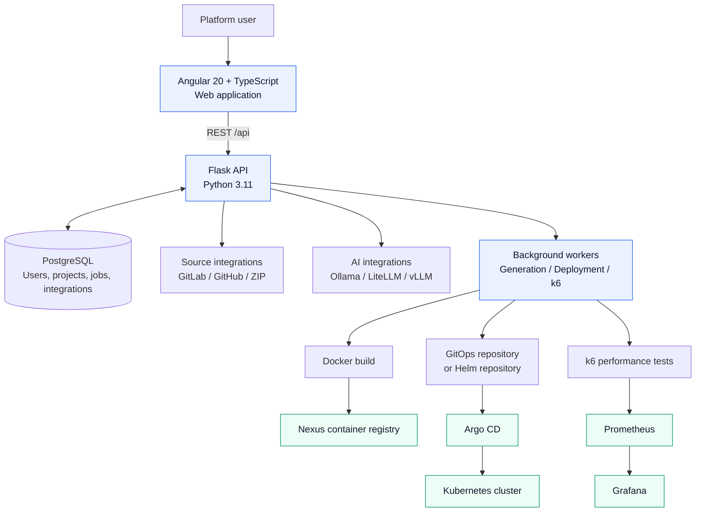

<div align="center">
  

  # Piximind Deploy
  ### Cloud-Native Internal Developer Platform

  **From source code to Kubernetes: project analysis, intelligent configuration generation, automated delivery, and performance observability.**

  <p>
    
    
    
    
  </p>

  <p>
    &nbsp;
    &nbsp;
    &nbsp;
    &nbsp;
    &nbsp;
    &nbsp;
    &nbsp;
    &nbsp;
    &nbsp;
    &nbsp;
    
  </p>

  *Summer internship project · Piximind*
</div>

---

## Overview

**Piximind Deploy** is a full-stack **Internal Developer Platform (IDP)** built to simplify application onboarding and delivery across Kubernetes environments. It provides a unified web interface for connecting development infrastructure, importing projects, analyzing source code, reviewing deployment configurations, triggering deployments, and monitoring results.

Instead of managing each tool independently, the platform coordinates an end-to-end workflow around **Docker, Nexus, Helm, Argo CD, Kubernetes, and GitOps**. Optional AI integrations support the generation of deployment artifacts; dedicated background workers handle long-running jobs.

> **Project context:** Developed as a summer internship project. This repository contains the application source code and supporting automation—not a complete, ready-to-run Kubernetes cluster or all external services.

### Core capabilities

| Area | What the platform provides |
| --- | --- |
| **Project onboarding** | Create and manage projects, connect GitLab/GitHub repositories, and import source archives. |
| **Source analysis** | Inspect project sources and detect deployment-relevant characteristics. |
| **AI-assisted generation** | Generate and review deployment artifacts using compatible AI providers such as Ollama, LiteLLM, or vLLM. |
| **Deployment orchestration** | Run background deployment jobs, build container images, publish artifacts, and coordinate environment delivery. |
| **GitOps delivery** | Publish Kubernetes/Helm configuration through a GitOps repository or Helm-based delivery and synchronize applications with Argo CD. |
| **Infrastructure integrations** | Manage connections to Kubernetes, Nexus, GitLab/GitHub, Argo CD, NFS, and AI services. |
| **Performance engineering** | Configure and execute k6 smoke, load, stress, spike, and soak tests. |
| **Observability** | Provision Prometheus and Grafana for k6 monitoring using Ansible and Helm. |
| **Administration** | Authentication, role-aware access, project ownership controls, dashboard, and notifications. |

## Architecture



**Architecture notes**

- **Angular** provides the interface; **Flask** exposes the REST API and coordinates business logic.
- **PostgreSQL** stores application state and job queues; workers execute generation, deployment, and performance tasks asynchronously.
- **Docker/Nexus** support image packaging and publishing; **Argo CD** manages GitOps-oriented Kubernetes delivery.
- **Prometheus/Grafana** are deployed for the k6 observability workflow through an Ansible playbook.
- External infrastructure and credentials must be configured separately; they are not automatically started by this repository.

## Delivery workflow

```mermaid
flowchart LR
    A[Import a project] --> B[Analyze source]
    B --> C[Prepare and review\ndeployment contract]
    C --> D[Generate and review\nartifacts]
    D --> E[Build container image]
    E --> F[Push to Nexus]
    F --> G[Publish GitOps / Helm\nconfiguration]
    G --> H[Sync via Argo CD]
    H --> I[Verify deployment]
    I --> J[Run k6 tests\nand inspect metrics]
```



The workflow combines platform-controlled review steps with automated execution. Artifact generation and deployment are handled by distinct backend modules and background workers; actual execution depends on the configured integrations and cluster permissions.

## Technology stack

| Layer | Technologies | Purpose |
| --- | --- | --- |
| **Frontend** | Angular 20, TypeScript, SCSS, Nginx | Dashboard, forms, project management, REST client, production static hosting. |
| **Backend** | Python 3.11, Flask 3, Gunicorn | HTTP API, business services, validation, integrations, worker commands. |
| **Persistence** | PostgreSQL, Psycopg 3 | Application state, users, job state, integration settings. |
| **Source control** | GitLab, GitHub, Git | Repository integrations and GitOps source management. |
| **Containers / registry** | Docker, Nexus | Build and publish container images. |
| **Orchestration / delivery** | Kubernetes, Helm, Argo CD | Application deployments and GitOps synchronization. |
| **Automation** | Ansible, `kubernetes.core` | Namespace-scoped observability provisioning. |
| **AI integrations** | Ollama, LiteLLM, vLLM, OpenAI-compatible APIs | Optional assistance with deployment configuration generation. |
| **Performance / monitoring** | k6, Prometheus, Grafana | Load scenarios, metrics, performance dashboards. |
| **Storage integration** | NFS | External persistent storage integration where configured. |

## Repository structure

```text
Devops_platform-main/
├── .gitlab-ci.yml                   # GitLab Runner / Nexus connectivity diagnostic
├── README.md
└── apps/
    ├── api/                         # Flask backend and worker services
    │   ├── app/
    │   │   ├── auth/                # Authentication and access control
    │   │   ├── admin/               # User administration
    │   │   ├── dashboard/           # Dashboard data
    │   │   ├── projects/            # Project onboarding and source handling
    │   │   ├── analysis/            # Source code analysis
    │   │   ├── workflow/            # Contracts, AI generation, review
    │   │   ├── generation/          # Generation-related endpoints/jobs
    │   │   ├── deployments/         # Deployment pipeline and workers
    │   │   ├── integrations/        # External service connectors
    │   │   ├── infrastructure/      # Infrastructure endpoints
    │   │   ├── performance/         # k6 testing and observability
    │   │   ├── notifications/       # Notification center
    │   │   ├── database.py          # PostgreSQL connection helpers
    │   │   └── config.py            # Environment-driven configuration
    │   ├── database/migrations/     # SQL schema migrations
    │   ├── ansible/observability/   # Prometheus/Grafana Helm automation
    │   ├── var/                     # Local/generated runtime workspaces
    │   ├── .env.example             # Configuration template
    │   ├── requirements.txt
    │   ├── Dockerfile
    │   ├── Dockerfile.k6-worker
    │   └── wsgi.py
    └── web/                         # Angular frontend
        ├── src/app/                 # Pages, features, services, routing
        ├── public/                  # Static assets / Piximind logo
        ├── nginx.conf               # Web serving and API reverse proxy
        ├── proxy.conf.json          # Angular dev proxy to Flask
        ├── package.json
        └── Dockerfile               # Multi-stage Angular + Nginx image
```

> **Note:** `apps/api/var/` includes sample/generated artifacts in the supplied repository. Runtime workspaces should generally be excluded from version control after reviewing their contents and sensitivity.

## Getting started (local development)

### Prerequisites

- **Python 3.11** and `pip` for the backend.
- **Node.js 22** and `npm` for the Angular frontend (the provided frontend Dockerfile uses Node 22).
- A reachable **PostgreSQL** database with the project's schema initialized.
- Optional for complete delivery workflows: Docker, Git, kubectl, Helm, an accessible Kubernetes cluster, Argo CD, Nexus, and the required service credentials.
- Optional for performance/observability workflows: k6, Ansible, and the `kubernetes.core` collection.

### 1. Clone the repository

```bash
git clone <REPOSITORY_URL>
cd <REPOSITORY_DIRECTORY>
```

Replace the placeholders with the URL and directory of your Git repository.

### 2. Configure and start the backend

```bash
cd apps/api

python3.11 -m venv .venv
source .venv/bin/activate
python -m pip install -r requirements.txt

cp .env.example .env
```

Edit `apps/api/.env` before starting the service. The following values are **required** by the Flask application:

```dotenv
APP_ENV=development
SECRET_KEY=<GENERATE_A_RANDOM_SECRET>
DATABASE_URL=postgresql://<USER>:<PASSWORD>@<HOST>:5432/<DATABASE>
CREDENTIAL_ENCRYPTION_KEY=<GENERATE_A_FERNET_KEY>
```

For local development, generate values instead of committing credentials:

```bash
python -c 'import secrets; print(secrets.token_urlsafe(48))'
python -c 'from cryptography.fernet import Fernet; print(Fernet.generate_key().decode())'
```

Set the generated values in `.env`. Use `.env.example` as the reference for other integration and worker settings.

**Database initialization:** SQL migrations live in `apps/api/database/migrations/`. Review and apply them to a new PostgreSQL database **in the project's intended sequence** before using the application. The archive does not include a documented automatic migration command; it also contains two migrations with the `026_` prefix, so do not blindly replay all SQL files against an existing database.

From `apps/api/`, start the development server:

```bash
flask --app wsgi:app run --host 127.0.0.1 --port 5000
```

Verify the API (a successful response also checks PostgreSQL connectivity):

```bash
curl http://127.0.0.1:5000/api/health
```

### 3. Start the frontend

In a **separate terminal**, from the repository root:

```bash
cd apps/web
npm ci
npm start
```

Open **http://localhost:4200**. The Angular development proxy forwards `/api` requests to `http://127.0.0.1:5000`.

### 4. Create an administrator (after schema initialization)

From `apps/api/` with the virtual environment active:

```bash
flask --app wsgi:app create-admin \
  --username admin \
  --email admin@example.com
```

The command prompts securely for a password; no password needs to appear in the shell history.

## Background jobs

Some features require long-running workers in addition to the HTTP server. Start the relevant command in a **separate terminal/process** with the same configured environment:

```bash
# AI-assisted configuration generation and review workflow
flask --app wsgi:app workflow-worker

# Deployment execution
flask --app wsgi:app deployment-worker

# k6 performance test execution
flask --app wsgi:app k6-worker

# Periodic integration connectivity checks
flask --app wsgi:app monitor-integrations
```

Worker processes depend on PostgreSQL and the tools/services used by each job. For production-style deployment, run them using an appropriate process supervisor or container orchestration rather than manual terminals.

## Docker builds

The repository contains **separate Dockerfiles** for the API, web UI, and k6 worker. From the repository root:

```bash
docker build -t piximind-deploy-api:dev ./apps/api
docker build -t piximind-deploy-web:dev ./apps/web
docker build -t piximind-deploy-k6:dev -f apps/api/Dockerfile.k6-worker ./apps/api
```

The frontend image serves Angular through Nginx and proxies API traffic to the configured `sapixi-api:5000` service name. Adjust service discovery/networking for your container environment. **No root-level Docker Compose file is included** in the supplied archive.

## Kubernetes, GitOps, and observability

- **Build and registry:** The deployment pipeline builds images and interacts with a Nexus container registry.
- **GitOps or Helm delivery:** The deployment contract determines whether generated delivery artifacts are published through a GitOps repository or a Helm-oriented flow.
- **Synchronization:** Argo CD is used to deliver and reconcile the target application in Kubernetes.
- **Diagnostics:** The platform includes deployment state tracking, execution logs, and health/diagnostic logic.
- **Performance:** k6 workers execute scenarios and can expose performance results to Prometheus/Grafana.

### Observability automation

The repository includes:

```text
apps/api/ansible/observability/playbook.yml
apps/api/ansible/observability/requirements.yml
apps/api/ansible/files/k6-dashboard.json
```

Install the required collection with:

```bash
ansible-galaxy collection install \
  -r apps/api/ansible/observability/requirements.yml
```

The playbook is invoked by the platform's observability provisioning logic with environment-specific variables (namespace, kubeconfig, release names, chart versions, and values). **It is not a standalone, zero-configuration cluster installer.**

## Security considerations

- Access control is enforced through authentication, role checks, and project/integration permissions.
- Integration credentials are encrypted by the application using **Fernet** and `CREDENTIAL_ENCRYPTION_KEY`.
- Keep `.env`, tokens, kubeconfigs, SSH keys, and local runtime artifacts **outside Git**.
- Use least-privilege access for Git, Nexus, Argo CD, and Kubernetes integrations.
- Review generated manifests, secrets, and configuration artifacts before applying them to a shared or production cluster.
- The included GitLab CI file currently provides **runner and Nexus connectivity diagnostics**; it should not be described as a fully implemented build/test/deploy pipeline.

## Validation and developer checks

```bash
# Frontend compile
cd apps/web
npm ci
npm run build

# Frontend test command (requires a suitable test/browser environment)
npm test
```

```bash
# Backend imports / route registration (requires configuration + database URL)
cd apps/api
flask --app wsgi:app routes

# HTTP + database health check
curl http://127.0.0.1:5000/api/health
```

The supplied archive includes an Angular test configuration but does not establish a complete automated backend test suite or an end-to-end CI test pipeline.

## Project status and next steps

This repository represents an **internship implementation / development-stage platform**, not a plug-and-play production distribution. Recommended follow-up improvements:

1. Add a reproducible PostgreSQL migration procedure with consistent migration identifiers.
2. Exclude generated `apps/api/var/` files and sensitive runtime data after reviewing them.
3. Add environment-specific Compose/Kubernetes deployment definitions and documentation.
4. Expand `.gitlab-ci.yml` beyond connectivity diagnostics to lint, test, build, scan, and publish stages.
5. Add backend tests, integration tests, and deployment smoke tests.
6. Document production hardening, secrets management, and backup/recovery procedures.
7. Add validated screenshots and deployment architecture evidence to `docs/`.

---

<div align="center">
  <strong>Piximind Deploy · Summer Internship Project</strong><br/>
  Built with DevOps, GitOps, Kubernetes, automation, and developer experience in mind.
</div>
